# UI 语言适配协议（i18n）

> 读者：改编辑器 UI / 菜单 / 面板 / 检查器文案的**主应用开发者**；贡献语言目录的翻译者；写扩展 UI 的社区开发者（另见 `Doc/ExtDev/extension_dev_protocol.md` §7）。
> 关联：`ui_protocol.md` §12（文本与字形安全）、§13（设置体系）；`test_protocol.md`（分层运行器）。
> 状态：**最小闭环已落地（2026-10-12）** — 目录外置 + 工具 + L1 守卫棘轮 + 设置枚举动态化；**2026-10-18 完成 270 处 UI 裸文案迁移与 zh 发布**；L2 字形覆盖与扩展审查器 C8/M7 标记为下一轮。

---

## 1. 主旨

**分工的支点是"源语言单一事实源 + 目录外置 + CI 门"**：

- 开发者只写 **key + 源语言（en）文案**，不写译文、不碰翻译文件；
- 译文进**目录文件**（`Locale/<lang>.json`），永不进代码；
- **CI 门**（本文 §6）保证：新增 UI 必带语言版本；新增语言必须全量适配后才可发布；
- **发布门（2026-10-18 强化）**：非 en 目录默认不进入语言表，必须
  `_meta.ui_complete=true` 且 `i18n_baseline.json` 的 `total=0` 才可显示。禁止同一界面中英混排；
  本地开发者预览用 `FVE_I18N_SHOW_DRAFTS=1`（或旧名 `MGE_I18N_SHOW_DRAFTS=1`）。
  v1 当前发布 `en` + `zh`（2026-10-18 完成全量迁移）。
- **宿主**（`Application/Editor/I18n.py`）保证回退链、即时切换与字形管线。

一句话职责：**代码里没有可翻译的裸字面量；目录里没有孤立键；语言表由目录推导。**

---

## 2. 角色分工

| 角色 | 负责 | 不负责 |
|---|---|---|
| 主应用开发者 | 写 `t("key")`、en 源文案、布局中性、自由度标注（§11） | 译文、目录维护 |
| 翻译者 / 社区 | `Locale/<lang>.json` 译文与 `_meta`（自称、reviewed） | 改任何 `.py` |
| 宿主 `I18n` | 目录装载/注册、回退链、语言表推导、覆盖率报告、即时切换 | 文案内容裁决 |
| CI / 守卫 | 键完备性、占位符一致性、棘轮、字形覆盖、场景目视 | — |
| 审查者（人） | 边界裁决（§4）、译文质量、`reviewed` 置位 | — |

```mermaid
flowchart LR
  D[开发者: t&#40;key&#41; + en 文案] --> X[i18n_tool extract]
  X --> C[(Locale/*.json 单一事实源)]
  T[翻译者/社区] --> C
  D --> RT[I18n 运行时: 注册+回退+字体]
  C --> RT
  C --> G[CI 守卫: check + 棘轮 + 字形]
  D --> G
  G --> RT
```



---

## 3. 键规范

- **格式**：`area.sub.item`，全小写点分，正则单一权威 = `I18n.KEY_PATTERN`
  （`^[a-z][a-z0-9_]*(\.[a-z0-9_]+)+$`）。示例：`settings.common.font_size`、`menu.edit.preferences`。
- **可提取性（硬约束）**：键必须在源码中**可静态找到**。合法形态两种：
  1. 直接常量：`t("settings.common.font_size")`；
  2. **注册表携带键**：`t(page.title_key)`，且该对象在构造处写了 `title_key="<键>"`
     （提取器两处同时识别；面板标题见 §5）。
- **禁止**：普通文案用 f-string 键（`t(f"...")`）、变量键、拼接键 —— 工具 `check` 直接报错。
- **动态显示名（唯一例外）**：`node.<snake_type>` / `comp.<snake_type>` / `menu.node_group.<snake>`
  由节点/组件注册表在运行期拼键（`Application/Editor/DisplayLabels.py`）；
  工具按命名空间跳过 unused 检查，由 `test_i18n_coverage` 递归遍历 `_TYPES` / `MENU_SECTIONS` 保证每个类型都有词条。
  新增普通 UI 文案仍必须走常量 `t("key")`。
- **稳定性**：已发布的键**不改名**（改名 = 新增键 + 旧键保留一个版本并在目录标 `deprecated`）。
- **不使用**：用户数据（实体名/场景名/模型名）、协议标识符（node type、pin 名、op 名）作为键。

---

## 4. 不翻译边界表（**唯一裁决处**）

| 类别 | 是否翻译 | 依据 |
|---|---|---|
| 面板/菜单/按钮/标签/提示/表头 | ✅ 翻译（走 `t()`） | 本文 §3 |
| **面板窗口标题** | ✅ 翻译（`BasePanel.title_key`；imgui ID 经 `###<name>` 固定） | §5 |
| 节点/组件**显示名**（Add 菜单、检查器标题） | ✅ 已接入（`node.<snake_type>` / `comp.<snake_type>`；缺失回退英文 label） | 2026-10-18 裁决 |
| node `type` id、pin 名、op 名、`.scene`/`.mat` 字段名 | ❌ 永不翻译 | 契约稳定性（JSON + MCP 文档） |
| 用户数据（实体名/场景名/资源名/数据集名） | ❌ | 数据 ≠ 文案 |
| 快捷键提示（`Ctrl+S` 等） | ❌（守卫按模式豁免） | 键盘布局惯例 |
| imgui 内部 id（`##x`、`open_popup`/`begin_child`/`push_id` 参数、`MainDockSpace`） | ❌（守卫排除） | 无可见文案 |
| **agent 面向文本**：op 摘要、`[Module]`/`[Project]` 等日志、协议文档 | ❌ **语言 = 中文，不随 `ui.language` 变化** | 2026-10-12 裁决（双份维护无收益） |
| 调试/告警 print | ❌（且受 GBK 控制台约束 — `ui_protocol` §12.2 规则 5） | — |

---

## 5. 运行时契约（`Application/Editor/I18n.py`）

- **目录位置**：`Application/Editor/Locale/<lang>.json`（env `MGE_LOCALE_DIR` 覆盖 = 测试沙箱）。
- **目录文件结构**：
  ```json
  { "_meta": {"language": "zh", "name": "中文", "source": false, "reviewed": true, "ui_complete": true,
              "fonts": ["C:/Windows/Fonts/msyh.ttc", "/System/Library/Fonts/PingFang.ttc"]},
    "strings": { "settings.common.language": "语言" } }
  ```
  `_meta`：`language`（代码）/`name`（自称，进设置面板选项）/`source`（en = true）/`reviewed`（人工审校）/
  `ui_complete`（发布门：**true 前必须 reviewed，且 baseline total=0**）/
  `fonts`（可选，该语言需要合并的字形文件绝对路径；**唯一字体表**）。
- **回退链**：当前语言 → `en` → 键名原文（**永不抛错**；占位符异常也回退不崩）。
- **语言表由目录推导**：`available_languages()`（en 恒首位，**默认只返回已发布语言**）→
  设置面板 `Common ▸ Language` 选项、`EditorSettings` 的 `ui.language` 枚举校验
  （`_allowed_choices`）**同源**。`all_catalog_languages()` 返回含草稿的全部目录，仅供校验/报告。
  → 新增语言只加一个 JSON，但 **ui_complete=false 时不会出现在 UI**（防混排）。
- **扩展目录**：`register_catalog(owner, lang, mapping, meta=None)` / `unregister_catalogs(owner)`
  （与 `_purge_ops`/`_purge_ui` 对称；键命名空间 `ext.<id>.*`）。
- **面板标题**：`BasePanel.title_key = "<键>"` → `begin_panel()` 用 `t(title_key) + "###" + name`
  渲染；**id 固定**故语言切换不影响 dock 身份。
- **节点/组件显示名**：`I18n.t_optional(key, fallback)`（`DisplayLabels.py` 拼 `node.<snake>` /
  `comp.<snake>` / `menu.node_group.<snake>`）；缺失回退英文 label，扩展节点无需语言包也能显示。
- **字体管线**：`I18n.font_candidates()` 汇总所有目录（含草稿）的 `_meta.fonts` 并去重；
  `EditorImguiLayer._merge_cjk_font()` 只消费该列表（`CJK_FONT_CANDIDATES` 仅向后兼容兜底）。
  **新增语言只加字体路径到 JSON，不改宿主/渲染层代码** —— 这是语言适配正交性的关键边界。
  切换即时生效（imgui 立即模式）。

---

## 6. 守卫三层（验证机制）

| 层 | 内容 | 载体 | 阻断 |
|---|---|---|---|
| **L1 静态** | ① 代码键 ⊆ en；② 可提取性（无 f-string/动态键）；③ 每语言键集 == en；④ 占位符集合跨语言一致；⑤ 键规范；⑥ 非空译文；⑦ **棘轮**：未迁移裸文案数与每文件预算不得增长；⑧ **发布门**：非 en 的 `ui_complete=true` 必须 baseline `total=0`，否则不得进入语言表 | `Test/Application/Editor/test_i18n_coverage.py`（core） | ✅ CI |
| **L1' 工具门** | 同上 + 报告/骨架：`python Utils/Dev/i18n_tool.py check [--strict]`（退出码 0/1） | `Utils/Dev/i18n_tool.py` | ✅ CI |
| **L2 字形** | 新语言必须证明字形就绪（Pillow 渲染 sample vs notdef 对比） — 防 `?` 现象的新语言版本 | 守卫扩展 + `_meta.fonts` | [M1] |
| **L3 场景/目视** | 逐语言渲染设置页 + 断言文本非 `?` 且不截断；伪本地化（`en-XA`）压布局 | `scenarios/i18n_smoke.py` | [M1] |
| 扩展侧 | C8（扩展 imgui 字面量未经 `t()`/`ctx.i18n` 报错）+ M7（`locale/*.json` 校验） | `FlyVibing-User-And-Developer-Utils/packages/extension-kit/review_extension.py` | [M1] |

### 6.1 棘轮口径（唯一算法 = `i18n_tool.count_ui_literals`）

不计入的（有明确理由，非"视而不见"）：
1. 经 `t()` 的参数（含 f-string 内插值 `f"{t('x')}##id"`）；
2. `##` 之后的 imgui id、printf 格式串（`%.2f`）、纯符号/数字；
3. 不渲染文案的调用：`open_popup` / `begin_popup*` / `begin_child` / `push_id` / `set_next_window_*` 等（`_NON_TEXT_FUNCS`）；
4. 快捷键模式 `Ctrl+X` 等；
5. 基线 `exclude_files`（死文件/未注册页）与 `exempt`（逐条 `{file?, text, reason}`）；
6. `node.*` / `comp.*` / `menu.node_group.*` 动态显示名（由注册表覆盖测试保证完整）。

**基线文件**：`Doc/Dev/i18n_baseline.json`（进版本库）：
```json
{ "generated": "2026-10-18", "total": 0,
  "files": {},
  "exclude_files": [".../MenuBarPanel.py"], "exempt": [{"file": "...", "text": "MainDockSpace", "reason": "..."}] }
```
- **只减不增**：迁移后 `i18n_tool.py literals --write` 刷新（total 与每文件预算同时下降）；
- 新增裸文案 → 守卫点名文件与增量（实测输出：`SettingsPanel.py: 2 -> 3 (+1)`）；
- 需要新增豁免 → 必须写 `reason`，并在本文 §4 边界表能找到依据。

---

## 7. 新增语言 Runbook（全量适配门槛）

**门槛不合格 = 该语言不可发布**（不满足则 `check --lang` 失败，目录不放行）。

1. `python Utils/Dev/i18n_tool.py add-lang <code>` — 生成骨架（所有键、空值、`_meta` 待填）；
2. 填译文；`_meta.name` = 该语言自称（`日本語` / `Deutsch`）；`_meta.reviewed=true` 需人工审校后置位；
3. `python Utils/Dev/i18n_tool.py check --lang <code> --strict` → **0 error / 0 warning**；
4. 字体：在目录 `_meta.fonts` 补该脚本字体绝对路径（Windows/macOS/Linux 可并列；空 = 不需要字形合并）；
   **不改 `EditorImguiLayer` / 任何 `.py`** —— 宿主只读取目录元数据；
5. 节点/组件显示名：补 `node.*` / `comp.*` / `menu.node_group.*`（缺失自动回退英文 label，不阻断发布）；
5. 字形覆盖测试（L2）通过（非 notdef）；
6. 场景目视（L3）：设置面板 → `Language` 出现该语言（自动）→ 切换 → 截图存档；
7. 文档：本文 §8 语言表加行；`Doc/User` 相关说明如需；
8. 回归：core 全量 + `check`（全语言）。

---

## 8. 语言表（当前）

| 代码 | 自称 | 状态 | 覆盖 | 备注 |
|---|---|---|---|---|
| `en` | English | **源语言 / 已发布** | 100% | 代码里的键必须在此存在 |
| `zh` | 中文 | **已发布** | 100% | 270 处裸文案已迁移；`ui_complete=true`；字体见 `_meta.fonts` |

---

## 9. 迁移棘轮与现状

- **存量**：2026-10-18 已迁移全部 270 处可见裸文案（17 文件；最大：`ScenePanel` 71、`widgets/flow_io` 48、`node_editor/panel` 46）。
- **当前结论（2026-10-18）**：`zh` key 覆盖 100%，`baseline.total=0`，`ui_complete=true`，
  设置 `Common ▸ Language` 已出现中文；切换后主菜单 / 面板标题 / Scene / Resources / Node Editor / Settings 全部中文。
- **剩余边界**：node type id、pin 名、op 名、组件字段名、用户数据按 §4 保持英文/原样（契约稳定性）；
  节点/组件**显示名**与 Add 菜单分类已由 `node.*` / `comp.*` / `menu.node_group.*` 覆盖。
- **新增语言**：只增 `Locale/<lang>.json`（含 `_meta.fonts`），不改上层代码；
  `available_languages()` / 设置枚举 / 字体合并自动跟随。

---

## 10. 证据与测试映射

| 机制 | 测试/证据 |
|---|---|
| 目录完备 / 键集 / 占位符 / 键规范 | `Test/Application/Editor/test_i18n_coverage.py`（core, 32 checks） |
| 棘轮（总量 + 每文件预算） | 同上 §4 段；实证：临时加 1 处裸文案 → `FAIL 271 <= 270` + 点名 `SettingsPanel.py: 2 -> 3 (+1)` |
| 新语言并入（沙箱加 `xx`） | 同上 §5 段：语言表/自称/覆盖率/设置枚举/面板选项/切换 全部自动跟随 |
| 扩展目录注册与卸载 | 同上 §6 段 |
| 边界（agent 面不随语言变化） | §4 表 + `test_action_contract`/文档面不受影响 |
| 工具门 | `Utils/Dev/i18n_tool.py check --strict` → `OK (0 errors, 0 warnings)`；`ui_complete=true` 但 `baseline.total>0` 直接 ERROR |

---

## 11. 扩展侧约定（[M1] 落地）

- 扩展自带语言包：`<ext_dir>/locale/<lang>.json` → `I18n.register_catalog("ext.<id>", lang, strings)`；
- 键一律 `ext.<id>.*` 前缀（与 op 命名空间一致）；卸载 → `unregister_catalogs("ext.<id>")`；
- 审查器 **C8**（UI 字面量未走 `t()` → FAIL）与 **M7**（`locale/*.json` 键集对齐 en → FAIL）为下一轮；
- 在此之前，扩展 UI 文案的安全集约束（`ui_protocol` §12 + reviewer C7）仍然生效。
